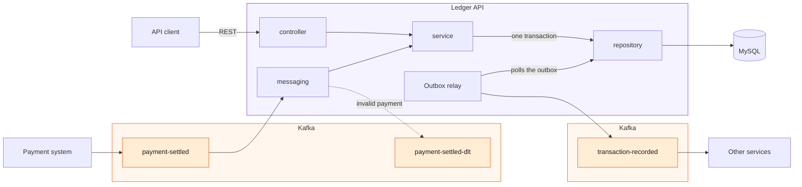

# Ledger API

A double-entry ledger. Money is held in accounts and moves only through transactions whose debits and credits
balance. A recorded transaction is never changed: a mistake is corrected by a reversal, which is a new transaction.
Transactions are recorded through a REST API and from `payment-settled` messages, and every recorded transaction is
announced on Kafka.

Java 17, Spring Boot 4, Spring Data JPA (Hibernate), MySQL 8.4, Liquibase, Kafka 4.2, Maven (wrapper included).

## Design



- A request and a settled payment go through the same `service`, which records a transaction in one database
  transaction: it locks the accounts, checks the rules, and writes the transaction, its entries, the answer on the
  idempotency key and a row in the `outbox`.
- The outbox relay publishes those rows to `transaction-recorded`.
- A `payment-settled` message the ledger cannot record (malformed, an unknown account, the wrong currency) goes
  unchanged to `payment-settled-dlt`, a Kafka topic like the other two, so the messages behind it go on. Any other
  failure is retried.

### API

- **Resources** under `/v1`: accounts with their entries and past balances, transactions, and the reversal of a
  transaction (singular: a transaction is reversed at most once).
- **Versioning:** `v1` only grows, so clients ignore unknown fields.
- **Amounts** are decimal strings, `BigDecimal` in the code and `DECIMAL(19, 4)` in MySQL, so `0.10 + 0.20` is exactly
  `0.30`. A JSON number is accepted too and read exactly.
- **Errors** are `{"errorCode", "message"}`:
  - `400` a malformed request (Spring Boot's standard error body);
  - `404` an unknown id;
  - `409` a transaction already reversed, or a reversal;
  - `422` a broken rule;
  - `503` the accounts are busy.
- **API first:** the contracts came before the code, and the tests check every response and message against them.

### Pessimistic locking

- Recording a transaction locks its accounts in one `SELECT … FOR UPDATE`, in id order, then checks the rules and
  writes, all in one database transaction.
- So no overdraft limit is broken, no update is lost, and A → B and B → A cannot deadlock, on any number of instances,
  since they share only MySQL.
- Not optimistic locking: it would retry all the time, since every payment in a currency touches its settlement
  account.
- A lock not obtained in 5 seconds is answered `503` with `Retry-After`, and nothing is recorded.
- A `UNIQUE` index on `reversal_of` allows one reversal per transaction.

### Idempotency

- The key is first reserved, in a short transaction of its own.
- The transaction that records the effect then locks the key's row and stores in it a hash of the request and the
  answer, with the effect: both are committed, or neither.
- A retry gets the stored answer, on any instance. A copy sent at the same time waits for the first. After a crash
  before the commit, the retry runs as a first attempt.
- A refusal (`404`, `409`, `422`) is stored like a success; `400` and `503` are not stored.
- The same key with a different request gets `422 IDEMPOTENCY_KEY_REUSED`.

### Outbox and Kafka

- **Why Kafka:** it keeps messages for replay, orders them within a partition and shares partitions among the
  instances of a consumer group.
- **Outbox:** a recorded transaction writes its message to an `outbox` table, in the same database transaction.
- **Relay:** runs every 200 ms on every instance, but only the one holding the lock on the single `outbox_publisher`
  row publishes. It sends in outbox order to `transaction-recorded` (one partition), waits for each acknowledgement,
  then marks the messages published.
- **Message:** the transaction as the API returns it, keyed by its id, with the `X-Request-Id` (or the payment id) in a
  `correlationId` header.

### The payment-settled consumer

- Every instance consumes `payment-settled` in the group `ledger`; `payment-settled` has 2 partitions, so two
  instances share the work.
- A payment debits the settlement account of its currency and credits the merchant.
- It goes through the same idempotency, with the key `payment-settled:<paymentId>`, so a copy under any event id
  records nothing. The offset is committed after the transaction.
- A message the ledger cannot record (malformed, unknown account, wrong currency) goes unchanged to
  `payment-settled-dlt`, with `errorCode` and `errorMessage` headers, and the next one goes on. The refusal is not
  stored, so the payment can be sent again once its cause is fixed.
- Any other failure (MySQL down, a busy account) is retried until it succeeds.

### Code structure

- `controller` (REST) and `messaging` (Kafka) call one method of a `service`, which owns the database transaction.
- The `service` calls `validation` and `repository`, the only place with queries.
- The `model` classes are plain JPA entities. Every rule of a transaction is in `TransactionValidator`, checked against
  locked accounts and unit-tested without Spring.
- Requests, responses and messages are DTOs (`dto`), never entities. Every refusal is a `LedgerException` with an
  `ErrorCode`.
- Tests are `unit` (plain JUnit) or `integration` (MySQL and Kafka in Testcontainers, with a second instance of the
  service for the guarantees of section 6).

## What a consumer of `transaction-recorded` can rely on

- *Can it miss a transaction?* No. The message is committed with the transaction and stays in the outbox until Kafka
  acknowledges it. A refused transaction is never announced.
- *Can it see one twice?* Yes. A send not acknowledged within 5 seconds is sent again by the next relay run, and Kafka
  may still deliver the first attempt: during a 16-second Kafka pause, one transaction arrived 3 times. A relay that
  dies before marking a message published sends it again too. Copies are identical: deduplicate on the id (the key).
- *In what order?* Transactions on the same account arrive in the order they were applied, and a reversal after its
  original. Transactions with no account in common may arrive in either order.
- *What if the service crashes right after recording one?* The message is already in the outbox: another instance, or
  the same one restarted, publishes it. While Kafka is down, messages wait there and go out in order later.

## Run

You need Docker, Git and a JDK 17 or newer.

```bash
git clone https://github.com/Daniel296/ledger-api.git
cd ledger-api
./run.sh
```

`run.sh` builds the service, starts it in Docker with MySQL and Kafka, waits until it is healthy, then runs the tests.
The tests start their own MySQL and Kafka (Testcontainers), so they never touch the running service's data.

- API: `http://localhost:8080` (health: `/actuator/health`). Contract: [docs/openapi.yaml](docs/openapi.yaml).
- Kafka messages: [docs/asyncapi.yaml](docs/asyncapi.yaml). From the host, Kafka is `localhost:9094`.
- MySQL: `localhost:3308`, database, user and password `ledger`.
- Stop everything: `docker compose -f docker/docker-compose.yml down -v` (`-v` also deletes the data).

## Examples

They follow the challenge's examples: Merchant 42 is paid 125.50 EUR, paid out 98.50 EUR with a fee of 1.50, and the
payout is reversed. Run them in this order, from the repository, on the stack `run.sh` started. Each answer is shown
under its command as a comment, trimmed.

### Accounts

Every `POST` needs an `Idempotency-Key`. The same request with the same key is a retry: it gets the same answer and
opens nothing. The id is the first field of every answer, so the commands keep it in a variable.

```bash
curl -i localhost:8080/v1/accounts -H 'Content-Type: application/json' \
    -H 'Idempotency-Key: open-merchant-42' -d '{"currency": "EUR"}'
# HTTP/1.1 201
# Location: http://localhost:8080/v1/accounts/1f25741e-b407-4fa3-b49c-d811626e53ff
# {"id":"1f25741e-b407-4fa3-b49c-d811626e53ff","currency":"EUR","overdraftLimit":"0.00","balance":"0.00",…}

MERCHANT=$(curl -s localhost:8080/v1/accounts -H 'Content-Type: application/json' \
    -H 'Idempotency-Key: open-merchant-42' -d '{"currency": "EUR"}' | cut -d '"' -f 4)
PAYOUTS=$(curl -s localhost:8080/v1/accounts -H 'Content-Type: application/json' \
    -H 'Idempotency-Key: open-payouts-eur' -d '{"currency": "EUR"}' | cut -d '"' -f 4)
FEES=$(curl -s localhost:8080/v1/accounts -H 'Content-Type: application/json' \
    -H 'Idempotency-Key: open-fees-eur' -d '{"currency": "EUR"}' | cut -d '"' -f 4)
```

### A settled payment (example 1)

The script plays the payment system: it publishes a `payment-settled` message with Kafka's console producer, inside
the Kafka container, under a new event id every time. The ledger records it within a second or two. Sending the same
`paymentId` again is a redelivery and records nothing.

```bash
./scripts/send-payment-settled.sh "$MERCHANT" 125.50 EUR pay-42
# Sent: {"eventId": "330b21f3-…", "paymentId": "pay-42", "merchantAccountId": "1f25741e-…", "amount": "125.50", …}

curl localhost:8080/v1/accounts/$MERCHANT
# {"id":"1f25741e-…","currency":"EUR","overdraftLimit":"0.00","balance":"125.50",…}
```

### A transaction (examples 2 and 5)

A payout with a fee, read back, then one refused for the overdraft limit. `X-Request-Id` is optional; it comes back on
the response and goes into the logs and the announcement.

```bash
PAYOUT_REQUEST='{"description": "Payout to Merchant 42", "entries": [
    {"accountId": "'$MERCHANT'", "direction": "DEBIT", "amount": "100.00"},
    {"accountId": "'$PAYOUTS'", "direction": "CREDIT", "amount": "98.50"},
    {"accountId": "'$FEES'", "direction": "CREDIT", "amount": "1.50"}]}'
curl -i localhost:8080/v1/transactions -H 'Content-Type: application/json' \
    -H 'Idempotency-Key: payout-42' -H 'X-Request-Id: payout-42' -d "$PAYOUT_REQUEST"
# HTTP/1.1 201
# X-Request-Id: payout-42
# Location: http://localhost:8080/v1/transactions/199b4524-9fb9-4e9e-9893-6a206255fc62
# {"id":"199b4524-…","description":"Payout to Merchant 42","currency":"EUR",
#  "entries":[{"accountId":"1f25741e-…","direction":"DEBIT","amount":"100.00"},
#             {"accountId":"d60ddaf5-…","direction":"CREDIT","amount":"98.50"},
#             {"accountId":"edb7a92d-…","direction":"CREDIT","amount":"1.50"}],
#  "recordedAt":"2026-11-10T23:07:44.199618Z"}

PAYOUT=$(curl -s localhost:8080/v1/transactions -H 'Content-Type: application/json' \
    -H 'Idempotency-Key: payout-42' -d "$PAYOUT_REQUEST" | cut -d '"' -f 4)
curl localhost:8080/v1/transactions/$PAYOUT
# the same transaction

curl -i localhost:8080/v1/transactions -H 'Content-Type: application/json' \
    -H 'Idempotency-Key: payout-too-large' -d '{"description": "Payout too large", "entries": [
    {"accountId": "'$MERCHANT'", "direction": "DEBIT", "amount": "50.00"},
    {"accountId": "'$PAYOUTS'", "direction": "CREDIT", "amount": "50.00"}]}'
# HTTP/1.1 422
# {"errorCode":"OVERDRAFT_LIMIT_EXCEEDED",
#  "message":"Account 1f25741e-… would go to -24.50, past its overdraft limit of 0.00"}
```

The other refusals of example 5 answer `422` too, and record nothing: `UNBALANCED`, `TOO_MANY_DECIMAL_PLACES`,
`CURRENCY_MISMATCH`, `TOO_FEW_ENTRIES` and `UNKNOWN_ACCOUNT`; an account in `EURO` or `ABC` gets `INVALID_CURRENCY`, one
in `GBP` `UNSUPPORTED_CURRENCY`. The message names the value at fault.

### A reversal (example 3)

The payout is reversed, then a second reversal is refused. `ASOF` notes the time before it, for the past balance below.

```bash
sleep 1; ASOF=$(date -u +%Y-%m-%dT%H:%M:%SZ)

curl -i -X POST localhost:8080/v1/transactions/$PAYOUT/reversal -H 'Idempotency-Key: reverse-payout-42'
# HTTP/1.1 201
# Location: http://localhost:8080/v1/transactions/11838a6f-9410-49d1-976d-12c6f73d3917
# {"id":"11838a6f-…","description":"Reversal of 199b4524-…","currency":"EUR","entries":[…],
#  "recordedAt":"2026-11-10T23:07:45.909786Z","reversalOf":"199b4524-9fb9-4e9e-9893-6a206255fc62"}

curl -i -X POST localhost:8080/v1/transactions/$PAYOUT/reversal -H 'Idempotency-Key: reverse-payout-42-again'
# HTTP/1.1 409
# {"errorCode":"TRANSACTION_ALREADY_REVERSED","message":"Transaction 199b4524-… was already reversed"}
```

### Entries and a past balance

Entries come newest first, each with the balance after it; the next page starts after `nextCursor`.

```bash
curl "localhost:8080/v1/accounts/$MERCHANT/entries?limit=2"
# {"entries":[{"transactionId":"11838a6f-…","direction":"CREDIT","amount":"100.00","balanceAfter":"125.50",…},
#             {"transactionId":"199b4524-…","direction":"DEBIT","amount":"100.00","balanceAfter":"25.50",…}],
#  "nextCursor":"3"}
curl "localhost:8080/v1/accounts/$MERCHANT/entries?limit=2&cursor=3"
# {"entries":[{"transactionId":"571f8335-…","direction":"CREDIT","amount":"125.50","balanceAfter":"125.50",…}]}

curl "localhost:8080/v1/accounts/$MERCHANT/balance?asOf=$ASOF"
# {"accountId":"1f25741e-…","currency":"EUR","balance":"25.50","asOf":"2026-11-10T23:07:45Z"}
```

### Dead letters and announcements

A payment the ledger cannot record goes unchanged to `payment-settled-dlt`, with the reason in its headers. Every
recorded transaction is announced on `transaction-recorded`. Stop each consumer with Ctrl-C.

```bash
./scripts/send-payment-settled.sh 00000000-0000-0000-0000-000000000000 10.00 EUR
docker compose -f docker/docker-compose.yml exec kafka /opt/kafka/bin/kafka-console-consumer.sh \
    --bootstrap-server localhost:9092 --topic payment-settled-dlt --from-beginning --formatter-property print.headers=true
# errorCode:UNKNOWN_ACCOUNT,errorMessage:Account 00000000-0000-0000-0000-000000000000 does not exist,… {"eventId":…}

docker compose -f docker/docker-compose.yml exec kafka /opt/kafka/bin/kafka-console-consumer.sh \
    --bootstrap-server localhost:9092 --topic transaction-recorded --from-beginning --formatter-property print.key=true \
    --formatter-property print.headers=true
# correlationId:pay-42     571f8335-…  {"id":"571f8335-…","description":"Payment pay-42 settled",…}
# correlationId:payout-42  199b4524-…  {"id":"199b4524-…","description":"Payout to Merchant 42",…}
# correlationId:2b8d6a03-… 11838a6f-…  {"id":"11838a6f-…","description":"Reversal of 199b4524-…",…}
```

## What the tests prove

The integration tests run against the real MySQL and Kafka (Testcontainers). Where it says "two instances", a second
copy of the application runs next to the first, on the same database and broker; the tests that race requests run
5 times each.

**Concurrency, on two instances** (`ConcurrentTransactionsShould`)
- 20 payouts of 10.00 at once from an account with a 100.00 overdraft limit: exactly 10 pass, the rest are refused.
  `neverTakeAnAccountPastItsOverdraftLimit`
- 50 transfers of 1.00 at once into one account: it ends at exactly 50.00. `neverLoseAnUpdate`
- 40 transfers at once, half A → B and half B → A: all of them pass, none deadlocks.
  `notDeadlockWhenMoneyMovesBothWaysAtOnce`
- 10 reversals of the same transaction at once: one passes, 9 are refused.
  `reverseATransactionOnlyOnceWhenBothInstancesReverseItAtOnce`
- 10 copies of one request, with one idempotency key, at once: one transaction.
  `recordATransactionOnceWhenBothInstancesGetTheSameIdempotencyKeyAtOnce`

**Retries** (idempotency)
- A retry, its body written differently, gets the same status, body and `Location`, and the money moves once.
  `TransactionApiShould.recordATransactionOnceAndAnswerItsRetryWithTheOriginalResponse`
- A request refused for its overdraft limit is still refused on retry after the account was funded; another request
  on that key gets `IDEMPOTENCY_KEY_REUSED`. `TransactionApiShould.answerTheRetryOfARefusedRequestWithTheSameRefusal`
- 10 copies of a refused request at once all get the same refusal.
  `ConcurrentRetriesShould.refuseEveryCopyOfARefusedRequestSentManyTimesAtOnce`
- A first attempt that writes and then dies before its commit leaves nothing; the retry records the transaction once.
  `IdempotencyServiceShould.recordATransactionOnceWhenTheFirstAttemptDiedBeforeCommitting`
- The same key with another body, or for another transaction, is refused.
  `TransactionApiShould.refuseAnIdempotencyKeyReusedForADifferentRequest`

**Settled payments** (redelivery)
- The same payment sent 3 times, once under a new event id, is recorded once; a copy with another amount goes to the
  dead letters. `PaymentSettledConsumerShould.recordAPaymentOnceUnderWhateverEventIdAndDeadLetterACopyWithAnotherAmount`
- 20 payments, each sent to both partitions so that both instances get it at once: each is recorded once.
  `ConcurrentPaymentsShould.recordEveryPaymentOnceWhenBothInstancesReceiveItAtOnce`
- A payment that comes back because its offset was not committed is not recorded again.
  `ConcurrentPaymentsShould.recordAPaymentOnceWhenItComesBackAfterAnInstanceRecordedItAndDiedBeforeCommittingItsOffset`
- A malformed message, one for an unknown account and one in the wrong currency go unchanged to the dead letters, and
  the payment behind each is recorded. `PaymentSettledConsumerShould.deadLetterAMessageItCannotRecordUnchangedAndRecordTheOnesBehindIt`

**Integrity**
- 200 transfers and reversals race on two instances; while they run, every currency adds up to zero and every
  balance equals the sum of its entries. `LedgerIntegrityShould`
- A refused transaction records nothing, changes no balance and announces nothing.
  `TransactionApiShould.leaveNothingBehindWhenATransactionIsRefused`,
  `TransactionAnnouncementsShould.announceNothingForARefusedTransactionOrReversal`
- A recorded transaction is never updated. `TransactionRepositoryShould.neverUpdateARecordedTransaction`
- Money is exact by construction (`BigDecimal`, `DECIMAL(19, 4)`, never `double`); `CurrencyShould` checks the decimal
  places, and `TransactionValidatorShould` every rule of example 5.

**Announcements**
- 20 payments and their reversals, on two instances: each announced once, in the order it was applied.
  `ConcurrentAnnouncementsShould`
- Recorded while Kafka is down, announced once it is back; left behind by a publisher that died, announced by another;
  sent by a publisher that died before marking it, sent again as an identical copy. `OutboxRelayShould`

## AI usage

I used Claude Code (Anthropic) as a pair programmer throughout the project.

- **For what:** breaking the challenge into small steps (a few commits each, see the history), and drafting the code,
  the tests and the documentation of each step under my direction.
- **How I checked it:** every change is built and tested (`./mvnw verify`) before I commit it, and every API response
  and Kafka message the tests see is checked against its contract. Each step was also reviewed by a second model,
  independent of the one that wrote it; every finding was fixed, decided with me, moved to a later step or dropped
  with a reason. I read every diff and made every commit myself; the design decisions are mine.
- **Instruction files:** the ones written for this project are committed in [.claude](.claude):
  [CLAUDE.md](.claude/CLAUDE.md) (stack, domain rules, code and test conventions),
  [implement-step](.claude/skills/implement-step/SKILL.md) (the process every step follows),
  [ledger-reviewer](.claude/agents/ledger-reviewer.md) (the independent reviewer), and
  [settings.json](.claude/settings.json) with [require-review.sh](.claude/hooks/require-review.sh), a hook that does
  not let a step end before its review has been launched.

## Improvements

What I would change before production.

**Settled payments**
- A message that fails every time for a bug stops its partition: alert on the lag of the consumer group `ledger`.
- Re-sending from `payment-settled-dlt` is manual (the script, same `paymentId`): a tool to replay chosen messages.
- The topics belong to the payment system; the ledger creates them only for the demo.

**Announcements**
- Duplicates during a Kafka outage: let the producer give up itself (`delivery.timeout.ms`) instead of the relay's
  5-second timeout, so a send the relay gave up on is never delivered later.
- Published rows stay in the outbox: delete them after a few days.
- One message at a time, about 600 a second: send in batches with the idempotent producer.
- A publisher that hangs without dying keeps the lock until MySQL drops its connection: a lease that expires instead.
- Metrics and alerts: messages not published, the age of the oldest. Reading the binlog (Debezium) instead of polling.
- More partitions for more consumers: one message per entry, keyed by account, keeps the order per account. The count
  is chosen up front, since adding partitions to a live topic breaks the order.

**Under pressure**
- Every payment in a currency queues on its settlement account: split it into several rows, summed for its balance.
- Fewer round trips under the accounts' locks: the entries of a transaction in one multi-row `INSERT` and the account
  `UPDATE`s in one batch (measured: 10 round trips to 9 for a transfer, 16 to 8 for one on 5 accounts).
- Idempotency keys never expire (the contract promises at least 24 hours): a `reserved_at` column and a purge job.

**Entries and past balances**
- `recordedAt` is the recording instance's clock: a skew can misplace a transaction right at an `asOf`. MySQL's clock,
  read under the accounts' lock, would not.
- A past balance on a busy account reads every entry after `asOf`: copy the time onto entries, indexed with the account.

**Running and deploying**
- Spring profiles per environment (`application-prod.yml`), with secrets outside `docker-compose.yml`.
- Expand/contract migrations, so two versions run side by side during a deploy.
- In CI: oasdiff for breaking API changes, the AsyncAPI CLI on `docs/asyncapi.yaml`, a dependency scan.
- Time-ordered UUIDs (version 7) as `BINARY(16)`: smaller indexes, inserted in order.

**Security** (not implemented: the challenge does not ask for it)
- Authentication: every caller, internal service or merchant, identifies itself.
- Authorization: a merchant reads only its own accounts and cannot move another merchant's money (`403`); payouts,
  fees, reversals and the settlement accounts are for internal services only.
- Idempotency keys per caller (caller + key) instead of global, as the IETF idempotency-key draft recommends.
- Kafka with TLS and ACLs: only the payment system may publish `payment-settled`.
- Already in place: DTOs separate from entities, parameterised queries, at most 100 entries per transaction, bounded
  amounts, no stack traces in errors, random UUIDs, locks against races, idempotency against replays.
